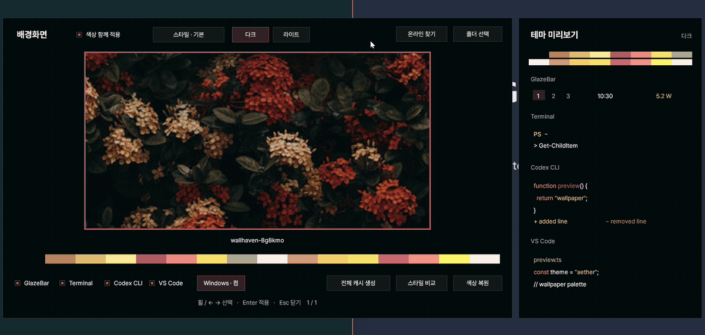
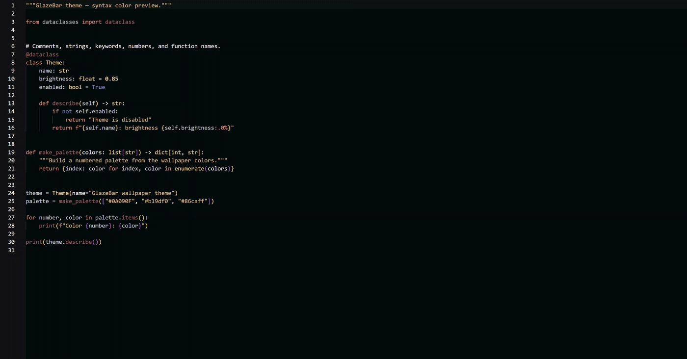

# GlazeBar + GlazeWM

> **Latest: 0.1.0-preview.8 · Windows 11 x64 / ARM64.** Fixes false Remote Desktop auto-pause triggers from WSL2/WSLg (`msrdc.exe`) and adds default `ignore` rules for Windows Task Manager (`Taskmgr`) and Hancom Office helper windows.

[한국어](README.md) · [English](README.en.md)

**This bundle installs GlazeWM and a native top bar.**

After seeing Omarchy, I wanted something like it on Windows and started using GlazeWM. But Zebar, the WebView2-based bar I used with it, felt pretty heavy on my machine. So I built a new bar in Rust and kept adding little features I wanted along the way.

The bundle includes **both GlazeBar, a native Rust status bar, and a modified GlazeWM 3.10.1**.
GlazeWM handles windows and workspaces. GlazeBar shows system stats and gives you quick access to brightness, Wi-Fi, battery info, and a few other things.

> This is an independent community bundle, not an official GlazeWM release! Just a personal project I'm figuring out as I go.

The font is Pretendard, color extraction comes from Aether, and the UI is based on Omarchy Quattro.

- **Default font:** [Pretendard](https://github.com/orioncactus/pretendard)
- **Color extraction:** palette extraction algorithms from [Aether](https://github.com/omacom/aether), ported to Rust
- **UI design:** based on [Omarchy Quattro](https://github.com/omacom/omarchy/tree/quattro), implemented with native Windows UI

## Download

| Your PC | Bundled installer |
| --- | --- |
| Intel / AMD Windows | [x64 setup EXE](https://github.com/lamininA1/GlazeBar/releases/download/v0.1.0-preview.8/GlazeBar-GlazeWM-Setup-0.1.0-preview.8-x64.exe) |
| Windows on ARM | [ARM64 setup EXE](https://github.com/lamininA1/GlazeBar/releases/download/v0.1.0-preview.8/GlazeBar-GlazeWM-Setup-0.1.0-preview.8-arm64.exe) |

## Install

1. Download the setup EXE for your PC.
2. Close GlazeWM and GlazeBar if they're running.
3. Run the installer and follow the steps. You can also choose whether to start automatically when you sign in.
4. Open **GlazeBar + GlazeWM** from the Start menu.

**No commands to type, and no separate GlazeWM download needed.** Your existing settings are backed up before installation.
Both architectures run modified GlazeWM 3.10.1-glazebar.2 from your user profile. Official 3.10.1 stays installed for CLI compatibility and rollback.

GlazeBar doesn't need .NET, Go, or WebView2 installed. If the Visual C++ runtime needed by GlazeWM is missing, the installer downloads Microsoft's setup program for you.
Windows may ask for administrator approval while installing GlazeWM or the runtime.

### Updating from an earlier version

Close GlazeWM and GlazeBar, uninstall **GlazeBar + GlazeWM (community setup)** from Windows Settings → Apps, then run the new installer. The uninstaller restores the files from before installation and keeps any files you edited afterward in a separate folder, so you can bring your own settings over from that backup.

## Features

- **Workspaces and windows** — workspace indicators, window layout shortcuts, fullscreen support
- **System stats** — CPU, memory, battery level, and charging/discharging power
- **Quick settings** — Wi-Fi, brightness, display scaling, and power plans
- **Wallpapers and themes** — wallpaper picker, color extraction, theme application, and Wallhaven search. Apps can follow your wallpaper colors, much like Omarchy!

Pick a wallpaper and let the theme follow its colors!

VS Code changes too. The demo uses Python, but it works with Rust, JavaScript, and other languages as well.

### What I added to my old Zebar setup

These are the things I missed in the Zebar bar I was using.

- **Brightness and display scaling** — a brightness slider in the bar and a scaling menu below its icon
- **Wi-Fi connection menu** — scan, pick a network, and connect
- **Power plan switching** — choose performance, balanced, or power saver from the bar
- **Wallpaper picker** — browse local pictures or search and download from Wallhaven, with search filters, page jumps, saved searches and tags, a persistent preview cache and a heart collection ([guide, Korean](docs/wallhaven-browser.md))
- **Themes from pictures** — extract colors, switch between dark and light, and preview six different styles
- **App and Windows colors** — match the colors of whichever apps you want
- **Color restore and caching** — go back to previous colors and reuse palettes you've already generated

### What gets themed?

Turn on **색상 함께 적용** (apply colors too) in the wallpaper picker and select the apps you want. You can also change just the wallpaper.

| Target | What changes |
| --- | --- |
| GlazeBar + GlazeWM | Bar, popups, and active window border |
| Windows Terminal | Background, text, cursor, and terminal colors |
| Codex CLI | Code and diff colors |
| VS Code | Editor, sidebar, tabs, status bar, terminal, and syntax colors |
| Windows | Dark/light mode, accent color, title bars, Start menu/taskbar, and transparency |

You can choose which Windows settings to change separately. Use dark mode for taskbar accent colors.
App integration currently targets Windows installations. Codex settings inside WSL still need to be themed separately.

Comment colors keep a muted hue that stays distinct from body text while meeting a contrast threshold against the background. [Details](docs/comment-colors.md)

## Modified GlazeWM

The bundle includes a build of [upstream GlazeWM](https://github.com/glzr-io/glazewm) v3.10.1 (3.10.1-glazebar.2) with these changes:

- **Alt+M minimize and restore** — natively minimizes the windows of the current workspace and restores them with the split layout, proportions and focus order intact.
- **Empty split cleanup** — removes empty split containers left behind after windows are closed or moved, and gives their space back.
- **Focus handling** — avoids sending needless input to a window that already has focus, and compares the actual OS focus with the WM's state.

The patch and change log are in [GlazeWM changes](docs/glazewm-modifications.md). GlazeWM keeps its upstream GPL-3.0 license, and the modified source is included in the installer.

## Shortcuts

| Shortcut | Action |
| --- | --- |
| `Win + F1` | Show all shortcuts |
| `Win + Alt + Shift + B` | Show / hide the bar |
| `Win + Ctrl + Alt + Space` | Open the wallpaper picker |
| `Alt + Shift + E` | Exit GlazeWM |

## Memory and CPU usage

Measured on my **Surface Pro 11 · Snapdragon X Plus X1P-64-100 (10 cores) · Windows 11 ARM64**.

| Metric | Previous Zebar + WebView2 setup | Rust GlazeBar |
| --- | ---: | ---: |
| Memory (working set) | 799.7 MiB | 25.18 MiB |
| Private Bytes | 331.4 MiB | 5.05 MiB |
| CPU usage (% of total CPU capacity) | 0.058% | 0.047% |
| Resident processes | 13 | 1 |

Quite a bit lighter on memory! These were separate measurements taken during development, so treat the CPU difference as a rough reference. Zebar includes its child processes; Rust values are averages over the sample period. The details and original data are in the [measurement notes (Korean)](docs/performance.md).

## Uninstall and restore settings

Close GlazeWM and GlazeBar, then uninstall **GlazeBar + GlazeWM (community setup)** from **Windows Settings → Apps**.
Files from before installation are restored, and files you edited afterward are kept separately.

To remove GlazeWM too, uninstall **GlazeWM** from the app list as well. Your applied Windows theme and wallpaper stay as they are.

## A few notes

- Windows 11 x64 / ARM64. The ARM64 package is cross-built on x64.
- Still a preview, and the binaries aren't code-signed yet.
- Brightness and power settings can vary by device. External-monitor DDC/CI brightness control isn't available yet.
- Weather is set to Seoul for now, using the free Open-Meteo API ([terms](https://open-meteo.com/en/terms)).

Found a problem or want a feature? Leave it in [Issues](https://github.com/lamininA1/GlazeBar/issues)!

## Changelog

- **preview.7** — fixes the GlazeWM errors that repeated after moving windows, when a window lost its workspace and monitor. Empty-split cleanup now runs just before redraw.
- **preview.6** — fixes comment colors turning into the body text color. After updating, pick your wallpaper/theme again and apply it to VS Code to regenerate the palette.
- **preview.5** — Wallhaven search filters, page jumps, saved searches and tags, persistent preview cache, heart collection, and cache size display.
- **preview.4** — adds the modified GlazeWM: Alt+M minimize/restore, empty-split cleanup, and focus handling. x64 / ARM64.
- **preview.3** — hides the Wi-Fi item on PCs without Wi-Fi. Popups close when you click another window or the bar, and stay open while you use their input fields and sub-settings windows.
- **preview.2** — fixes the bar exiting on PCs without WMI brightness support. Brightness is enabled per monitor depending on support.

## Source and licenses

GlazeBar is **GPL-3.0-only**. The installer also includes licenses and source code for the projects used in the bundle.

[License](LICENSE) · [Third-party notices](THIRD-PARTY-NOTICES.txt) · [Build instructions](distribution/BUILDING.md)

Projects used along the way: [GlazeWM](https://github.com/glzr-io/glazewm), [Aether](https://github.com/omacom/aether), [Lucide](https://github.com/lucide-icons/lucide), and [Inno Setup](https://jrsoftware.org/isinfo.php).
