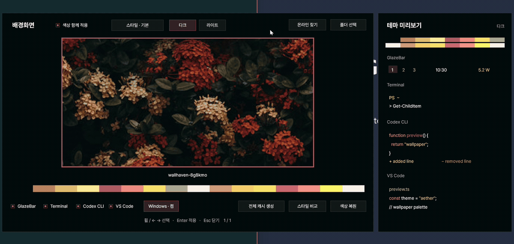
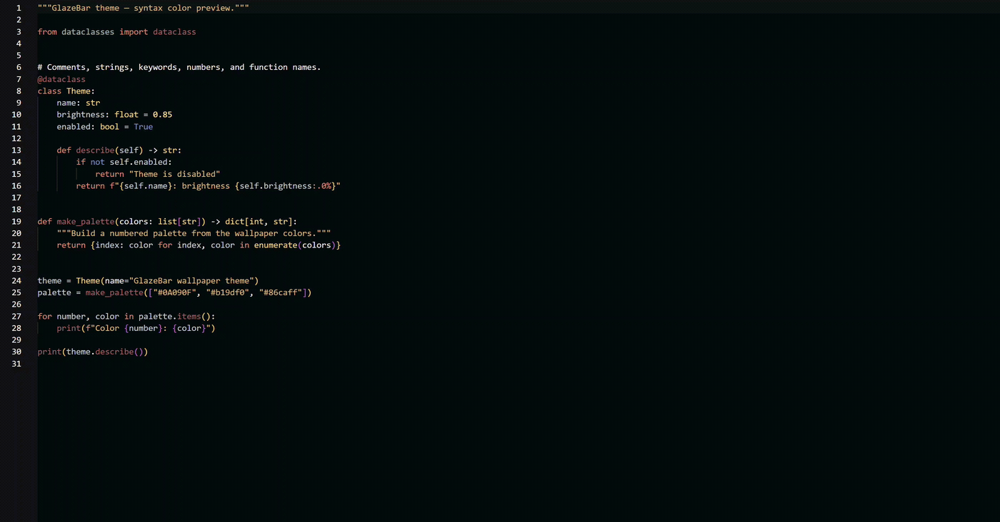

# GlazeBar + GlazeWM

> **preview.4 x64 / ARM64: 수정 GlazeWM 포함.** [원본 GlazeWM](https://github.com/glzr-io/glazewm) v3.10.1을 수정해 Alt+M의 실제 최소화·배치 보존 복원, 빈 분할 정리와 포커스 처리를 개선했습니다. ARM64에도 동일한 수정본을 포함합니다. ARM64는 교차 빌드했으며 실제 장치 검증은 별도입니다. 한영 입력 증상은 사용자가 기존 Codex 세션에 한정된 것으로 확인했으며, 이번 배포를 IME 수정으로 주장하지 않습니다. [변경 내역과 검증](docs/glazewm-modifications.md).

[한국어](README.md) · [English](README.en.md)

**본 저장소는 GlazeWM과 Topbar를 설치합니다.**

Omarchy를 보고 Windows에서도 이런 환경을 써보고 싶어 GlazeWM을 사용하게 됐습니다. 그런데 함께 쓰던 Zebar가 WebView2 기반이라 제 환경에서는 꽤 무겁게 느껴지더라고요. 그래서 표시줄을 Rust로 새로 만들고, 쓰면서 필요했던 편의 기능도 하나씩 붙였습니다.

이 배포판에는 **Rust 상태 표시줄 GlazeBar와 GlazeWM 3.10.1이 모두 포함**되어 있습니다.
GlazeWM이 창과 작업공간을 관리하고, GlazeBar에서 시스템 상태를 확인하거나 밝기·Wi-Fi·배터리 상태 기타 등등을 확인할 수 있습니다.

> GlazeWM 공식 배포판이 아닌 독립적인 커뮤니티 번들입니다! 저는 아무것도 몰라요

글꼴은 Pretendard, 색상 추출은 Aether, UI는 Omarchy Quattro에서 가져왔습니다.

- **기본 글꼴:** [Pretendard](https://github.com/orioncactus/pretendard)
- **색상 추출:** [Aether](https://github.com/omacom/aether)의 팔레트 추출 알고리즘을 가져와 Rust로 이식
- **UI 디자인:** [Omarchy Quattro](https://github.com/omacom/omarchy/tree/quattro)의 UI를 바탕으로 Windows 네이티브 화면으로 구현

## 다운로드

| 사용하는 PC | 통합 설치 프로그램 |
| --- | --- |
| Intel / AMD Windows | [x64 설치 EXE](https://github.com/lamininA1/GlazeBar/releases/download/v0.1.0-preview.4/GlazeBar-GlazeWM-Setup-0.1.0-preview.4-x64.exe) |
| Windows on ARM | [ARM64 설치 EXE](https://github.com/lamininA1/GlazeBar/releases/download/v0.1.0-preview.4/GlazeBar-GlazeWM-Setup-0.1.0-preview.4-arm64.exe) |

## 설치

0.1.0-preview.3에서는 Wi-Fi를 사용할 수 없는 PC에서 해당 항목을 숨깁니다. 팝업을 한 번도 클릭하지 않았더라도 다른 창이나 Bar를 클릭하면 닫힙니다. 팝업 내부 입력란과 하위 설정 창으로 이동할 때는 유지됩니다.

0.1.0-preview.2에서는 WMI 밝기 조절을 지원하지 않는 PC에서 바가 종료되는 문제를 수정했습니다. 상주 프로세스 이름은 `GlazeBar.exe`, Windows 파일 설명은 `GlazeBar`입니다. 노트북·데스크탑 구분 대신 모니터의 기능 지원 여부를 확인하며, 지원하지 않는 밝기 조작은 비활성화됩니다. 외부 모니터 DDC/CI 제어는 아직 포함되지 않습니다.

1. PC에 맞는 설치 EXE를 다운로드합니다.
2. 실행 중인 GlazeWM과 GlazeBar가 있다면 종료합니다.
3. EXE를 실행하고 설치 안내를 따라갑니다. 로그인 시 자동 시작 여부도 선택할 수 있습니다.
4. 시작 메뉴의 **GlazeBar + GlazeWM**을 실행합니다.

**명령어 입력이나 별도의 GlazeWM 다운로드는 필요하지 않습니다.** 기존 설정은 설치 전에 백업합니다.
x64와 ARM64 모두 사용자 폴더의 수정 GlazeWM 3.10.1-glazebar.1을 실행합니다. 공식 3.10.1은 CLI 호환성과 원복용으로 유지합니다. 다른 버전이나 이전 커뮤니티 번들이 있으면 안내에 따라 먼저 정리해야 합니다.

GlazeBar에는 .NET·Go·WebView2 설치가 필요 없습니다. GlazeWM에 필요한 Visual C++ 런타임이 없는 경우에만 Microsoft 설치 프로그램을 내려받도록 안내합니다.
GlazeWM 및 런타임 설치 중 Windows 관리자 권한 확인이 나타날 수 있습니다.

## 주요 기능

- **작업공간과 창 관리** — 작업공간 표시, 창 배치 단축키, 전체 화면 대응
- **시스템 상태** — CPU·메모리·배터리 잔량·충방전 전력 표시
- **빠른 설정** — Wi-Fi, 화면 밝기, 디스플레이 배율, 전원 구성표
- **배경화면과 테마** — 배경화면 선택, 색상 추출, 테마 적용, Wallhaven 검색 (Omarchy처럼 각종 테마가 변경됩니다!)

배경화면을 고르면 사진에 맞춰 테마도 바뀝니다!

VS Code도 같이 바뀝니다. 영상은 Python이지만 Rust, JavaScript 등 다른 언어에도 적용돼요.

### 기존 Zebar 구성에서 추가한 기능

제가 쓰던 Zebar 바에 아쉬웠던 것들을 이것저것 붙였습니다.

- **밝기·배율 직접 조절** — 표시줄의 밝기 슬라이더와 아이콘 아래 배율 메뉴
- **Wi-Fi 연결 메뉴** — 주변 네트워크 검색, 선택 및 연결
- **전원 구성표 전환** — 고성능·균형·절전을 표시줄에서 선택
- **배경화면 선택기** — 로컬 사진 탐색과 Wallhaven 검색·다운로드
- **사진 기반 테마 생성 + 유명 컬러 스킴** — 사진 색상 추출(Aether 6가지 스타일)뿐만 아니라 **Catppuccin, Everforest, Rosé Pine, Monokai, Dracula, Tokyo Night** 등 유명한 컬러 스킴 선택 및 다크·라이트 비교 지원
- **확장된 앱·브라우저·Windows 색상 연동** — 설치된 앱만 자동으로 감지하여 테마를 적용하고, 설치되지 않은 프로그램은 오류 없이 건너뛰고 다음 프로그램에 적용
- **직관적인 GlazeBar 환경 설정 UI** — 상단 바의 설정 버튼으로 위젯 표시 여부, 날씨 도시(서울·부산·도쿄·뉴욕 등), 기본 터미널·브라우저 단축키, 창 간격, 테마 적용 대상을 한곳에서 변경
- **첫 실행 단축키 안내 & Quick Start 요약** — 처음 설치 후 실행 시 핵심 단축키 요약 카드가 포함된 단축키 안내 창을 자동으로 표시하고 상단 바 단축키 버튼으로 언제든 다시 열기 지원
- **색상 복원과 캐시** — 이전 색상으로 돌아가기, 뽑아둔 색상 재사용하기

### 테마가 적용되는 범위

**색상 함께 적용**을 켜고 원하는 앱을 골라주면 됩니다. 설치되지 않은 앱은 오류 없이 자동으로 건너뛰고 다음 프로그램에 테마를 적용합니다.

| 적용 대상 | 변경되는 부분 |
| --- | --- |
| GlazeBar + GlazeWM | 표시줄, 팝업, 활성 창 테두리 |
| Windows Terminal | 배경, 글자, 커서와 터미널 16색 팔레트 |
| Rio Terminal | `themes/glazebar-aether.toml` 테마 파일 생성 및 `config.toml` 테마 연동 |
| WezTerm | `~/.config/wezterm/colors/glazebar-aether.toml` 생성 및 `wezterm.lua` (`color_scheme`) 연동 |
| Alacritty | `%APPDATA%/alacritty/themes/glazebar-aether.toml` 생성 및 `alacritty.toml` 색상 블록 연동 |
| Hyper | `%APPDATA%/Hyper/.hyper.js` 및 `~/.hyper.js` 터미널 16색·배경·커서 연동 |
| PuTTY | Windows 레지스트리(`HKCU\Software\SimonTatham\PuTTY\Sessions\*`의 `Colour0`~`Colour21`) 및 `.reg` 테마 파일 자동 갱신 |
| VS Code | 편집기, 사이드바, 탭, 상태 표시줄, 터미널, 코드 문법 색상 |
| Zed Editor | `themes/glazebar-aether.json` 테마 생성 및 `settings.json` 테마 연동 |
| Codex CLI | 코드와 diff 색상 (`config.toml`) |
| Antigravity CLI | `~/.gemini/antigravity-cli` 테마 및 `colorScheme` 설정 |
| Claude / Claude Code | `~/.claude/settings.json` 및 Claude Desktop 테마 설정 |
| OpenCode | `~/.config/opencode/themes/glazebar-aether.json` 및 `opencode.json` 테마 연동 |
| Firefox | 프로필 `chrome/userChrome.css` 및 `user.js` 툴바·탭 강조색 연동 |
| Chrome / Edge | 브라우저 프로필 `Preferences` 다크/라이트 및 테마 시드 색상 연동 |
| Windows | 다크·라이트 모드, 강조색, 제목 표시줄, 시작 메뉴·작업 표시줄, 투명 효과 |

Windows 쪽은 바꾸고 싶은 항목만 따로 고를 수 있습니다. 작업 표시줄 강조색은 다크 모드에서 써주세요.
앱 연동은 Windows 설치 기준입니다. WSL 안의 Codex 설정은 아직 따로 적용해야 합니다.

### 메모리·CPU 사용량

제 **Surface Pro 11 · Snapdragon X Plus X1P-64-100(10코어) · Windows 11 ARM64**에서 확인했습니다.

| 항목 | 기존 Zebar + WebView2 | Rust GlazeBar |
| --- | ---: | ---: |
| 메모리(작업 집합) | 799.7 MiB | 25.18 MiB |
| 전용 메모리(Private Bytes) | 331.4 MiB | 5.05 MiB |
| CPU 점유율(전체 CPU 기준) | 0.058% | 0.047% |
| 상주 프로세스 | 13개 | 1개 |

메모리는 꽤 가벼워졌습니다! 개발하면서 따로 측정한 값이라 CPU 차이는 참고 정도로 봐주세요. Zebar는 자식 프로세스 합계, Rust는 구간 평균이며 자세한 조건은 [측정 기록](docs/performance.md)에 남겨뒀습니다.

| 단축키 | 동작 |
| --- | --- |
| `Win + F1` | 전체 단축키 안내 |
| `Win + Alt + Shift + B` | 상태 표시줄 표시 / 숨기기 |
| `Win + Ctrl + Alt + Space` | 배경화면 선택 |
| `Alt + Shift + E` | GlazeWM 종료 |

## 제거와 설정 복원

GlazeWM과 GlazeBar를 종료한 뒤 **Windows 설정 → 앱 → GlazeBar + GlazeWM (community setup)**에서 제거합니다.
설치 전 파일을 복원하고, 설치 후 수정한 파일은 별도로 보관합니다.

GlazeWM까지 지우려면 앱 목록에서 **GlazeWM**도 제거해주세요. 적용해둔 Windows 테마와 배경화면은 그대로 남습니다.

## 참고

- Windows 11 ARM64 / x64
- 아직 미리보기 버전이고 코드 서명은 없습니다.
- preview.4: 실제 x64에서 확인했습니다. ARM64는 교차 빌드 및 패키지 검사만 완료했으며 실제 ARM64 실행 검증은 별도입니다.
- 밝기와 전원 설정은 기기에 따라 다를 수 있습니다.
- 날씨는 일단 서울입니다. Open-Meteo 무료 API를 사용합니다([이용 조건](https://open-meteo.com/en/terms)).

문제가 있거나 원하는 기능이 있으면 [Issues](https://github.com/lamininA1/GlazeBar/issues)에 남겨주세요!

## 소스와 라이선스

GlazeBar는 **GPL-3.0-only**입니다. 함께 사용한 프로젝트의 라이선스와 소스도 설치 프로그램에 넣어뒀습니다.

[라이선스](LICENSE) · [제삼자 고지](THIRD-PARTY-NOTICES.txt) · [빌드 방법](distribution/BUILDING.md)

함께 사용한 프로젝트: [GlazeWM](https://github.com/glzr-io/glazewm), [Aether](https://github.com/omacom/aether), [Lucide](https://github.com/lucide-icons/lucide), [Inno Setup](https://jrsoftware.org/isinfo.php).
